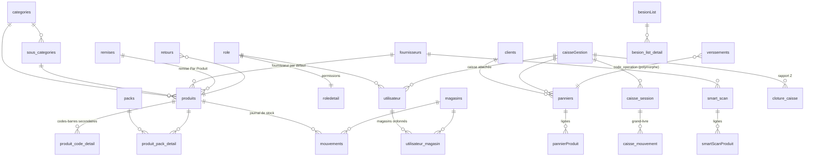

# CaisseDZ — Spécification de reconstruction (workflow, architecture, données)

> **Objet.** Ce document décrit **tout ce que fait l'application CaisseDZ actuelle**
> (branche `rebrand`, base SQLite **v52**, 13/10/2026) : architecture, classes,
> tables, règles métier, écrans, dialogs et workflows. Il sert de **cahier de
> référence** pour un nouveau projet construit sur le nouveau design system :
> le nouveau projet est conforme quand chaque case de la
> [§ 15 Checklist de conformité](#15-checklist-de-conformité) est cochée.
>
> Il a été rédigé à partir du **code réel** (pas seulement de
> `docs/02_architecture.md`, qui décrit une architecture idéalisée). Quand le
> code actuel contient un défaut qu'il ne faut **pas** reproduire, c'est signalé
> dans la [§ 16 Dette technique](#16-dette-technique--à-ne-pas-reproduire).
>
> Docs complémentaires : `docs/04_charte_graphique.md` (ancien design system),
> `docs/05_multi_magasin.md` (détail multi-magasin), `docs/workflow/` (captures).

---

## Sommaire

1. [Vue d'ensemble produit](#1-vue-densemble-produit)
2. [Stack technique](#2-stack-technique)
3. [Architecture du code](#3-architecture-du-code)
4. [Démarrage, activation, authentification](#4-démarrage-activation-authentification)
5. [Navigation, shell, favoris, alertes](#5-navigation-shell-favoris-alertes)
6. [Licences, rôles et permissions](#6-licences-rôles-et-permissions)
7. [Modèle de données (45 tables)](#7-modèle-de-données-45-tables)
8. [Règles métier transverses](#8-règles-métier-transverses)
9. [Modules — workflows détaillés](#9-modules--workflows-détaillés)
10. [Services externes (catalogue, Smart Scan IA)](#10-services-externes)
11. [Impression](#11-impression)
12. [Exports, sauvegarde, conformité fiscale](#12-exports-sauvegarde-conformité-fiscale)
13. [Localisation et listes de valeurs](#13-localisation-et-listes-de-valeurs)
14. [Composants UI à prévoir dans le design system](#14-composants-ui-à-prévoir-dans-le-design-system)
15. [Checklist de conformité](#15-checklist-de-conformité)
16. [Dette technique — à ne pas reproduire](#16-dette-technique--à-ne-pas-reproduire)

---

## 1. Vue d'ensemble produit

| Sujet | Valeur actuelle |
|---|---|
| Type | Point de vente (POS) + gestion de stock + gestion commerciale (clients, fournisseurs, caisses) |
| Plateforme | **Windows desktop** (Flutter). Taille mini fenêtre 1000×700, barre de titre personnalisée (bitsdojo_window) |
| Mode | **Offline-first** : toutes les opérations métier en SQLite local. Internet seulement pour : catalogue produits partagé, recherche Open Facts / Mantouj, Smart Scan IA |
| Langues | Français (défaut), Arabe (**RTL**), Anglais |
| Devise | DZD (paramétrable) |
| Licences | **Basic** (1 caisse, 1 magasin) / **Avancé** (multi-caisse, multi-magasin) |
| Utilisateurs | Multi-utilisateurs avec rôles et permissions fines |
| Conformité | Tickets scellés (SHA-256 chaîné), registre fiscal append-only, clôtures Z (art. 51 bis Code TVA) |
| Données seed | Admin `admin` / `123456`, magasin `MAG0000`, caisse `CIS0000`, client `CLN0000` « Comptoire », fournisseur `FOR0000` « Géneral », catégorie `CATE0000`, sous-catégorie `SC0000` |

---

## 2. Stack technique

| Domaine | Package(s) |
|---|---|
| Base | `sqflite_common_ffi` + `sqlite3.dll` compilée SQLCipher (`assets/libs/sqlite3.dll`) → `PRAGMA KEY`, `PRAGMA foreign_keys = ON` |
| Navigation | `go_router` (ShellRoute) |
| État | `provider` (`AuthState`, `LocaleProvider`) + singletons (`CaisseSessionState`) + `setState` local |
| Tableaux | `syncfusion_flutter_datagrid` (DataGrid unique dans toute l'app) |
| Graphiques | `fl_chart` |
| Sécurité | `flutter_secure_storage`, `crypto` (SHA-256), `encrypt` |
| Impression | `pdf`, `printing`, `print_bluetooth_thermal`, ESC/POS brut via spouleur Windows (`win32`/`ffi`), `barcode_widget`, `qr_flutter` |
| Exports | `excel`, `csv`, `archive` (zip de sauvegarde), `open_file`, `share_plus` |
| Médias | `image_picker`, `file_picker`, `image`, `flutter_image_compress`, `photo_view`, `camera` |
| Réseau | `http`, `dio` |
| Divers | `uuid`, `string_similarity` (matching OCR ↔ produits), `collection`, `device_info_plus`, `intl` |

---

## 3. Architecture du code

### 3.1 Arborescence

```
lib/
├── main.dart                 # bootstrap (DB, activation, auto-login, auto-backup, thème)
├── router.dart               # GoRouter + ShellRoute(AppShell)
├── DBCreate.dart             # schéma, migrations v1→v52, seed
├── data/
│   ├── constant.dart         # CodePrefix, ListsConst, ListsConstTranslator, AppConst
│   └── models/               # 47 modèles (constructor + fromMap + toMap + searchableText)
├── Services/                 # ~80 services (SQL, calculs, impression, exports, API)
├── screens/                  # 19 écrans (1 par module + login + activation)
├── core/
│   ├── Auth/                 # AuthState (session, permissions, magasins), LicenseTier
│   ├── Caisse/               # CaisseSessionState (paniers en cours, mémoire process)
│   ├── dialog/<module>/      # *_nouveau, *_modif, *_detail, *_actif (+ dialogs spécifiques)
│   ├── tableau/<module>/     # DataGrid : tableau_*.dart + *_source.dart (BaseTableDataSource)
│   ├── widget/               # afficheur/, card/, champ/, filtre/, situation/, title/, button/…
│   ├── theme/app_style.dart  # tokens Appstyle
│   ├── locale/               # LocaleProvider
│   └── utilis/               # stock_guard, quantite_format, number_format, barcode listener…
└── l10n/                     # app_fr.arb / app_ar.arb / app_en.arb (~1 470 clés)
```

### 3.2 Couches et flux réel

```
Screen (liste + filtres + afficheurs + DataGrid)
   │ ouvre
   ▼
Dialog (_nouveau / _modif / _detail / _actif)   ← ORCHESTRE les opérations multi-tables
   │ appelle plusieurs services (parfois dans une même transaction)
   ▼
Services (XxxServices(db) : SQL, ApiResponse<T>)
   │
   ▼
SQLite chiffré  ──►  le Screen recharge ses listes (callback onSuccess) et se reconstruit
```

Conventions réelles à connaître :

| Convention | Détail |
|---|---|
| Nommage dialogs | `_nouveau` = créer · `_modif` = modifier · `_detail` = lecture seule · `_actif` = activer/désactiver ou **annuler (soft)** / supprimer |
| Service | `class XxxServices { final Database db; XxxServices(this.db); }` — méthodes d'écriture d'instance, lectures souvent `static` (`getAllXxx()`), variantes `...WithTransaction(txn, …)` |
| Retour | `ApiResponse<T>{ success, message, data }` (`core/utilis/api_response.dart`) |
| Identifiants | `id` = `MAX(id)+1` ; `code` métier lisible généré par `CodeGenerator` + `CodePrefix` (§ 8.10) |
| Audit | Chaque table métier : `date_cree`, `cree_par_code`, `date_modif`, `modif_par_code`, `date_annul`, `annul_par_code`, `motif_annul`, `etat` |
| Suppression | Préférence pour l'**annulation douce** (`etat = 0` + motif) sur toutes les opérations financières/stock |
| Historique | Chaque action écrit une ligne `Historique` (type, description lisible, opération insertion/modification/suppression/login/logout) |
| Modèles | Classes mutables, pas de `copyWith`. Getter `searchableText` utilisé par la recherche globale des tableaux |
| Valeurs listées | Stockées **en français** en base, traduites à l'affichage via `ListsConstTranslator` (§ 13) |

### 3.3 Singletons / état global

| Classe | Rôle |
|---|---|
| `AuthState` (ChangeNotifier) | activation, palier licence, utilisateur connecté (`userCode`, `role`, `userCaisseCode`), `roleDetail` (permissions), `userParam` (langue/devise), `magasins` ordonnés, `magasinPrincipal`, `magasinsConsultation`, favoris, état sidebar, `contexteVersion` (incrémenté au changement caisse/magasin → les modules se rechargent) |
| `LocaleProvider` | langue courante, `isRTL` |
| `CaisseSessionState` | paniers en cours de l'écran Caisse + client sélectionné, conservés entre navigations |
| `QuantiteFormat` | nb de décimales des quantités (chargé au démarrage) |
| `AlertesServices.nombreAlertes` | `ValueNotifier` du badge de la cloche |

---

## 4. Démarrage, activation, authentification

### 4.1 Séquence de démarrage (`main.dart`)

```
1. sqfliteFfiInit + taille mini fenêtre
2. AuthState.loadActivationState()        ← secure storage + empreinte machine
3. verifyActivationOnStart()
4. tryAutoLogin() si "Rester connecté"      ← username + hash mémorisés (secure storage)
5. loadUserParameters()
6. DbCreator.openDb()                      ← ouverture / création / migration (v52)
7. QuantiteFormat.load()
8. BackupService.checkAndRunAutoBackup()   ← sauvegarde auto si due
9. GoRouter créé UNE fois (refreshListenable: authState)
```

### 4.2 Base de données

- Fichier : `%APPDATA%\Caisse DZ\caisse_real.db` + fichier caché `.mid` (identifiant machine).
- Clé SQLCipher = `sha256("CAISSE_<machineId>_SECRET")`, machineId dérivé de
  COMPUTERNAME + PROCESSOR_IDENTIFIER + SYSTEMDRIVE + `.mid`.
- **Le `.mid` doit voyager avec le `.db`** (sauvegarde/restauration), sinon base indéchiffrable.
- Données par défaut insérées seulement si l'app est activée ; filet de sécurité :
  si activée et table `utilisateur` vide → seed a posteriori.

### 4.3 Activation (écran `/activate`)

1. L'écran affiche l'**identifiant machine** (copiable).
2. L'utilisateur saisit la clé reçue. La clé = `SHA256(interleave(deviceId[#tier], secret))` en majuscules.
3. La clé est testée contre chaque palier → le palier trouvé est **débloqué** (Basic a le suffixe `#basic`, Avancé = format historique sans suffixe).
4. Stockage chiffré (XOR clé machine) + signature dans le secure storage : `activated`, `activation_signature`, `activation_timestamp`, `machine_fingerprint`, `license_tier`, `license_tier_signature`.
5. Non activé : seule connexion possible `demo` / `demo`.
6. Build debug : bouton de réinitialisation de l'activation.

### 4.4 Connexion (écran `/login`)

- Champs : nom d'utilisateur, mot de passe, case **« Rester connecté »**, lien vers activation si non activée, version.
- Hash : `sha256(password.trim() + "SYSTEM_SALT")`, requête `utilisateur WHERE username=? AND password=? AND etat=1`.
- Après succès, dans cet ordre : charger `roleDetail` → `userParam` (langue/devise) → favoris → magasins → Historique « Login ».
- Déconnexion : Historique « Logout », retour `/login`.

### 4.5 Séquence post-connexion (`AppShell.initState`)

```
Login OK → redirection /caisse
  → (1ʳᵉ connexion uniquement) InitialSetupDialog : infos boutique, paiements, marge, langue
  → AlerteDialog (seulement s'il y a des alertes)
  → Menu rapide des modules (grille des modules autorisés)
  → Si la caisse courante n'a pas de session ouverte → CaisseFermeeDialog → OuvertureCaisseDialog
```

Caisse courante : non-Admin = caisse attachée à l'utilisateur (`utilisateur.caisse_code`) ; Admin = la première caisse.

---

## 5. Navigation, shell, favoris, alertes

### 5.1 Routes

| Route | Écran | Catégorie sidebar | Permission (`roledetail`) |
|---|---|---|---|
| `/login` | LoginScreen | — | — |
| `/activate` | ActivationScreen | — | — |
| `/dash` | DashScreen | (en tête) | `dash` |
| `/caisse` | CaisseScreen | Ventes | `caisse` |
| `/pannier` | PannierScreen | Ventes | `pannier` |
| `/retour` | RetourScreen | Ventes | `retour` |
| `/produit` | ProduitScreen | Stock | `produit` |
| `/stock` | StockScreen | Stock | `stock` |
| `/entree` | EntreeScreen | Stock | `entree` |
| `/sortie` | SortieScreen | Stock | `sortie` |
| `/magasin` | MagasinScreen | Stock | **licence Avancé** (bloqué aussi par le router en Basic) |
| `/besoin` | BesionScreen | Stock | `besion` |
| `/client` | ClientScreen | Personnes | `client` |
| `/fournisseur` | FournisseurScreen | Personnes | `fournisseur` |
| `/utilisateur` | UtilisateurScreen | Personnes | `utilisateur` |
| `/gestion_caisse` | GestionCaisseScreen | Autre | `gestionCaisse` |
| `/zakat` | ZakatScreen | Autre | `zakat` |
| `/parametre` | ParametreScreen | Autre | `parametre` |
| `/historique` | HistoriqueScreen | Autre | `historique` |

Redirections : activé & non connecté → `/login` ; connecté vers `/login` ou `/activate` → `/caisse`.

### 5.2 AppShell (layout commun)

- **Sidebar** montée une seule fois : catégories dépliables (Ventes, Stock, Personnes, Autre), épinglable / réductible (icônes seules + tooltips), catégorie de la route active ouverte automatiquement, compte utilisateur en bas (menu : Mon compte, paramètres de caisse, déconnexion).
- **Ligne du haut** : onglets des **favoris** (max 7, clic = ouvrir, croix = retirer), zone de déplacement de fenêtre, boutons réduire/agrandir/fermer.
- **En-tête de chaque module** (`ConnectionStatusBar`) : 🔔 cloche Alertes (badge), ⭐ ajouter/retirer des favoris, témoin de connexion Internet.
- Transition fondu + glissement entre modules ; module reconstruit quand `contexteVersion` change.

### 5.3 Alertes (`AlertesServices.getAlertes`)

| Bloc | Règle | Visible si |
|---|---|---|
| Ruptures | produits actifs, stock (magasins consultables) ≤ `parametre.minimum` | produit / stock / besoin |
| Expirés | `date_empreint` < aujourd'hui | idem |
| Expirent bientôt | dans ≤ 30 jours | idem |
| Top 3 clients à crédit | achats − versements (Entrée) | client |
| Top 3 fournisseurs à crédit | achats − versements (Sortie) | fournisseur |
| Sessions non clôturées | session `ouverte` démarrée un jour précédent | gestionCaisse |

### 5.4 Mon compte

Lecture : code, dernier accès. Modifiable : nom d'utilisateur, mot de passe (ancien / nouveau / confirmation). Paramètres de caisse : choix de la caisse (si permission `changerCaisseMagasin`) et du **colis par défaut**.

---

## 6. Licences, rôles et permissions

### 6.1 Palier de licence (`LicenseTier`)

| Capacité | Basic | Avancé |
|---|---|---|
| Caisses | 1 | N |
| Magasins | 1 (rien n'est affiché) | N, module `/magasin`, champ « Magasins » sur l'utilisateur |
| Transfert magasin, distribution | — | ✔ |

Le palier est **orthogonal** au rôle : le palier dit ce que l'installation a acheté, le rôle ce qu'un utilisateur peut faire dedans.

### 6.2 Rôle (`role` + `roledetail`)

- Rôle **admin** unique, seedé (`rolenom = 'admin'` en minuscules) — toujours tester via `RoleServices.estRoleAdmin()` / `sqlEstAdmin()` (insensible à la casse). Le rôle admin n'est pas assignable ; pour d'autres administrateurs, créer un rôle dédié.
- `roledetail` : **16 accès modules** + **7 permissions d'action** (booléens) :

| Accès modules | Permissions d'action |
|---|---|
| dash, caisse, pannier, retour, produit, stock, entree, sortie, besion, client, fournisseur, utilisateur, gestionCaisse, zakat, parametre, historique | `voirPrixAchat`, `voirMarge`, `modifierPrixVente`, `annulerOperations`, `changerCaisseMagasin`, `gererTransfertsCaisse`, `voirStockTousMagasins` |

- Admin = toutes les permissions (`AuthState.can… = estAdmin || roleDetail.x`).
- Effets : prix d'achat / marges masqués, modification de prix bloquée en caisse, bouton Annuler refusé, onglet Transferts caisse « accès refusé », consultation de stock limitée à ses magasins.

### 6.3 Multi-magasin (Avancé)

- Un utilisateur = **1 caisse** + **liste ordonnée de magasins** (`utilisateur_magasin.ordre`, 0 = **principal**). Admin = tous les magasins (les siens d'abord).
- Une caisse **n'a plus de magasin** (`caisseGestion.magasin_code` conservé mais ignoré).
- `magasinsConsultation` = `null` (sans filtre) pour Admin ou `voirStockTousMagasins`, sinon les magasins de l'utilisateur.
- Règles de répartition → § 8.3.

---

## 7. Modèle de données (45 tables)

Toutes les tables métier portent les colonnes d'audit (§ 3.2) ; elles sont
omises ci-dessous sauf mention. `etat` : 1 actif / 0 annulé-inactif.
Les dates sont stockées en TEXT ISO-8601.

### 7.1 Diagramme simplifié



> `code_operation` (dans `mouvements`, `verssements`, `caisse_mouvement`) est une
> **référence polymorphe** vers le `code` d'un Pannier / SmartScan / Retour /
> Sortie / Transfert / Versement, sans clé étrangère.

### 7.2 Référentiel produits

**`produits`**

| Colonne | Type | Rôle |
|---|---|---|
| id, code (UNIQUE, `PRD…`), nom (UNIQUE), marque | | identité |
| description, code_barre, numero_serie, multicodebar (bool) | | codes-barres : principal + secondaires si multicodebar |
| fournisseur_code → fournisseurs, categorie_id → categories, sous_categorie_id → sous_categories, remise_id | | rattachements |
| prix_achat, prix_vente, tva | REAL | prix |
| marge_bool, marge_taux, marge_tauxPrct | | marge auto (montant / %) |
| unite_mesure | TEXT | Pièce / Kg / Litre / Mètre |
| nombre | REAL | compteur legacy du 2ᵉ stock « nombre » |
| nombre_actif | bool | force le 2ᵉ stock « nombre » pour ce produit |
| emballage1 / emballageP1 | REAL | **petit colis** : nb de pièces / prix du colis |
| emballage2 / emballageP2 | REAL | **grand colis** : nb de pièces / prix du colis |
| date_empreint | TEXT | **date d'expiration** |
| service | bool | produit-service : pas de stock |
| taille, couleur, photos (JSON de chemins), observation | | |
| besion | int | marqueur liste de besoin |
| device_id_mobile | | legacy (module mobile retiré) |

> ⚠️ **La quantité en stock n'est PAS stockée sur le produit** : elle est
> calculée depuis `mouvements` (§ 8.1).

| Table | Colonnes clés | Rôle |
|---|---|---|
| `produit_code_detail` | produit_code, codebar — UNIQUE(produit_code, codebar) | codes-barres secondaires |
| `categories` | code `CAT…`/`CATE0000`, nom, etat, observation | catégories |
| `sous_categories` | code `SC…`, nom (UNIQUE), categorie_code, categorie_id | sous-catégories |
| `remises` | code `REM…`, nom, type (`Par Montant`/`Par Produit`), montant (seuil), taux, taux_type (`Montant`/`Pourcentage`), debut, fin, etat | remises datées |
| `packs` | code `PCK…`, nom (UNIQUE), description, quantite_totale, prix_vente, prix_vente_original, etat | packs promotionnels |
| `produit_pack_detail` | pack_code, produit_code, prix_unitaire, quantite, montant | composition d'un pack |
| `produit_magasin_detail` | magasin_code, produit_code, nombre | compteur « nombre » par magasin (legacy, § 16) |
| `catalog_sync` | produit_code UNIQUE, catalog_product_id, code_produit (`CDZ-…`), sync_status (`pending`/`ok`/`error`), last_error, synced_at | correspondance avec le catalogue distant |

### 7.3 Stock

**`mouvements`** — *journal unique, source de vérité du stock*

| Colonne | Rôle |
|---|---|
| code (UNIQUE `MV00000001`), date | |
| code_produit → produits, quantite, nombre | quantité (et 2ᵉ stock) |
| prix_achat, prix_vente | valorisation au moment du mouvement |
| code_operation | code du document source |
| client_code, fournisseur_code | renseigné pour les retours (détermine le sens) |
| magasin_code → magasins | **1 mouvement = 1 produit + 1 magasin + 1 sens** |
| type | `Vente`, `Achat`, `Retour`, `Sortie`, `Distribution`, `Transfert` |
| sous_type | `Entrée` / `Sortie` pour Distribution et Transfert |
| etat | 0 = mouvement annulé (exclu du stock) |

| Table | Colonnes clés | Rôle |
|---|---|---|
| `magasins` | code `MAG…`, nom, adresse, etat, observation | magasins / dépôts |
| `utilisateur_magasin` | PK(utilisateur_code, magasin_code), ordre | magasins ordonnés d'un utilisateur |
| `transfert_magasin` | code `TRM…`, date, produit_code, quantite, nombre, magasin_source_code, magasin_dest_code, etat, observation | transfert de marchandise (→ 2 mouvements `Transfert` Sortie/Entrée) |
| `sortie` | code `SRT…`, date, type (`Expiration`/`Don`/`Autre`), produit_code, quantite, nombre, prix, montant, categorie_code, sous_categorie_code, magasin_code, observation | sortie exceptionnelle de stock |
| `besionList` | code `BL…`, numero, date, montant, nomber_article, quantite, fournisseur_code, etat (**TEXT**), observation | liste de besoin (bon de commande) |
| `besion_list_detail` | besion_list_code, produit_code, produit_nom, quantite, prix, montant | lignes de la liste |

### 7.4 Ventes

**`panniers`** (ticket / facture)

| Colonne | Rôle |
|---|---|
| code (UNIQUE `PN0000001`), date | |
| nombre_article, quantite_produit | nb de lignes / total des quantités |
| montant, montant_achat, marge | montant de vente (après remise), coût, marge |
| mode_paiement | Espèces / Carte / Chèque / Virement / Points |
| caisser_code → utilisateur, caisse (nom), caisse_code → caisseGestion | |
| client_code → clients | `CLN0000` = comptoir |
| type_pannier | `Ticket`, `BL_SC` (facture), `BL` (facture, legacy) |
| observation, uuid | |
| **hash, hash_precedent** | scellement fiscal SHA-256 chaîné par caisse |
| etat / date_annul / annul_par_code / motif_annul | annulation douce |

> Le **montant versé et le reste ne sont pas stockés** : calculés depuis `verssements` (§ 8.5).

| Table | Colonnes clés | Rôle |
|---|---|---|
| `pannierProduit` | code_pannier → panniers, code_produit, prix (unitaire vendu), quantite (en pièces), nombre, total, prix_achat, total_achat, etat | lignes de vente |
| `retours` | code `RET…`, date, type (`Client`/`Fournisseur`), code_produit, quantite, nombre, prix_achat, prix_vente, client_code / fournisseur_code, **retour_correspond_de** (code du panier ou du SmartScan d'origine), magasin_code, observation, etat | retours |

### 7.5 Achats / entrées

| Table | Colonnes clés | Rôle |
|---|---|---|
| `smart_scan` | code `SS…`, date, montant, nbr_produit, fournisseur_code, chemin_photo, observation, etat | **bon d'achat** (toutes les entrées de stock : manuelle multi-produits, rapide 1 produit, IA) |
| `smartScanProduit` | code_SmartScan → smart_scan, code_produit, quantite, nombre, prix (achat), prixVente, total, etat | lignes d'achat |
| `bon_reception` | fournisseur(_code), num_bon, commentaire, chemin_photo, date_reception, statut (`recu` → traité), traite_par_code, smart_scan_code | file d'attente de photos de bons à traiter par l'IA |

### 7.6 Tiers

| Table | Colonnes clés |
|---|---|
| `clients` | code `CL…`, nom (UNIQUE), telephone, email, fax, wilaya, adresse, type, activity, nif, nis, nrc, rib, banque, dernier_achat, **solde_bonus** (points fidélité), observation, etat |
| `fournisseurs` | code `FRN…`, nom, telephone, email, fax, wilaya, adresse, type, activity, observation, etat |

> Crédit / solde / total acheté **ne sont pas stockés** sur le tiers : calculés en
> direct (`ClientServices.getClientStats`, `FournisseurServices.getFournisseurStats`).

### 7.7 Argent

**`verssements`** (règlements)

| Colonne | Rôle |
|---|---|
| code (UNIQUE `VRS000001`), date | |
| typebeneficiare | `Client` / `Fournisseur` |
| beneficiare_code | code du client/fournisseur |
| type | `Paiement`, `Versement`, `Versement Sortie`, `Remboursement`, `Avancement`, `Complément de facture`, `Dette`, `Acompte`, `Remise` |
| sense | `Entrée` (argent qui entre en caisse) / `Sortie` |
| montant, mode_paiement, caisse (nom) | |
| code_operation | document réglé (panier, SmartScan, retour) |
| etat | 0 = annulé |

| Table | Colonnes clés | Rôle |
|---|---|---|
| `caisseGestion` | code `CS…`/`CIS0000`, nom_caisse, typecaisse (`Physique`/`Compte`), solde_initial, magasin_code (ignoré), etat | caisses |
| `caisse_session` | code `SES000001`, caisse_code, statut (`ouverte`/`cloturee`), solde_ouverture, date_ouverture, solde_theorique, solde_reel, ecart, date_cloture | session ouverture → clôture. **Index unique partiel : 1 seule session `ouverte` par caisse** |
| `caisse_mouvement` | code `MVC00000001`, session_code, caisse_code, type, sens, montant, mode_paiement, code_operation, client_code, fournisseur_code, motif, reference, date, etat | **grand-livre de caisse** (§ 8.6) |
| `transfert` | code `TRF…`, date_transfert, montant, caisse_exp_code, caisse_dest_code, observation, etat | transfert d'argent entre caisses |
| `cloture_caisse` | code `CLT000001`, caisse_code, date_debut, date_fin, total_ventes, total_annule, nombre_tickets, nombre_tickets_annules, repartition_paiement (JSON), utilisateur_code, hash, hash_precedent | rapport Z, immuable |
| `journal_fiscal` | code `JF…`, type_operation (`VENTE`, `ANNULATION_VENTE`, `CLOTURE_CAISSE`…), code_operation, caisse_code, utilisateur_code, montant, donnees_avant (JSON), donnees_apres (JSON), hash, hash_precedent, date_evenement | registre fiscal **append-only**, chaîné globalement |

### 7.8 Utilisateurs et sécurité

| Table | Colonnes clés |
|---|---|
| `utilisateur` | code `USR…`/`ADMIN`, username (UNIQUE), password (hash), nom, prenom, telephone, role (nom), role_code → role, caisse_code → caisseGestion, credit, dernier_acces, api_token (legacy), etat |
| `role` | code `ROL…`/`ADMIN`, rolenom (UNIQUE), observation, etat |
| `roledetail` | rolecode → role + 16 accès + 7 permissions (§ 6.2) |
| `module_favori` | PK(user_code, route), ordre |
| `userparam` | nom (= username, UNIQUE), magasin, magasinid, language, currency |
| `caisseparam` | user → utilisateur, caisse, caisseCode, magasin, magasinCode, **colis** (colis par défaut), magasinPD, caissePD |
| `Historique` | code `H…`, type (module), description, operation, cree_par_code, date_cree, observation |

### 7.9 Paramètres (tables à 1 ligne, id = 1)

| Table | Colonnes |
|---|---|
| `parametre` | type_marge (`montant`/`pourcentage`), taux_marge_montant, taux_marge_percentage, **minimum** (seuil rupture), maximum, decimales_quantite, active_bonus, bonus_taux, active_nombre_quantite, vente_sous_achat (`Interdire`/`Avertir`/`Autoriser`) |
| `zakatParam` | nissab, taux |
| `entreprise_param` | nom_boutique, logo_path, adresse, telephone, email, rc, nif, nis, article, message_ticket |
| `paiement_param` | especes_visible, carte_visible, cheque_visible, virement_visible |
| `imprimante_param` | type_imprimante (`bluetooth`/`usb`/`reseau`/`normale`), nom_imprimante, adresse_ip, port, mac_bluetooth, largeur_rouleau (58/80) |
| `backup_param` | dossier_backup, dossier_documents, auto_backup_actif, frequence (`demarrage`…), derniere_sauvegarde |
| `zakat` | code `ZKT…`, annee, date_debut_hawl, date_zakat_due, stock, liquidites, creances, dettes, capital_total, nissab, taux, obligatoire, montant_zakat, status (`Non payé`/`Payée`), date_paiement |

---

## 8. Règles métier transverses

### 8.1 Stock = journal des mouvements

```
stock(produit, magasins) = Σ quantite(mouvements entrants, etat=1) − Σ quantite(mouvements sortants, etat=1)
```

Sens (`MouvementsServices.estEntree`) :

| type | Sens |
|---|---|
| `Achat` | + entrée |
| `Vente`, `Sortie` | − sortie |
| `Retour` | + si `client_code` renseigné (retour client) · − sinon (retour fournisseur) |
| `Distribution`, `Transfert` | selon `sous_type` (`Entrée` + / `Sortie` −) |
| type inconnu | + (ne jamais faire disparaître une quantité) |

- Calcul en lot (`totauxParProduit`, `totauxPourFiltre`, `quantitesConsultables`) : une seule requête, agrégation mémoire.
- **Garde de stock** (`StockGuard`) : toute création / modification / annulation d'opération est refusée si elle rendrait le stock négatif (ex. annuler une entrée de 50 après une vente de 20). Les produits `service` sont exemptés.
- **2ᵉ stock « nombre »** (Paramètres › Nombre et quantité, ou `produit.nombre_actif`) : nombre de pièces physiques indépendant du poids (boucherie : kg + nb de pièces). Mouvementé partout comme la quantité ; **obligatoire (> 0)** à la saisie quand actif.

### 8.2 Colis / emballage

À l'ajout en caisse, l'utilisateur choisit **Pièce**, **Petit colis** (`emballage1` pièces au prix `emballageP1`) ou **Grand colis** (`emballage2` / `emballageP2`). La ligne garde `qte` en colis et `piecesParEmballage` ; **la quantité stockée/déstockée = qte × piecesParEmballage**. Le colis proposé par défaut vient de `caisseparam.colis` (`Toujours demandé`, `Petit colis`, `Grand colis`).

### 8.3 Répartition multi-magasin (`RepartitionStock`, fonctions pures testées)

| Opération | Règle |
|---|---|
| Vente | **séquentielle** : magasin 1 jusqu'à son stock, puis 2… ; 1 mouvement par magasin servi ; si le total manque, le reste va au principal |
| Retour fournisseur, Sortie | **un magasin qui a toute la quantité**, sinon séquentielle |
| Retour client | **vers les magasins d'où la vente est sortie**, le dernier servi d'abord, déduction des retours déjà faits ; surplus → premier magasin servi ; sans panier → principal |
| Entrée / Smart Scan | magasin **principal** |
| Distribution | répartir un produit entre magasins, **total inchangé** (deltas → mouvements Distribution Entrée/Sortie) |
| Transfert magasin | 2 mouvements `Transfert` (Sortie source, Entrée destination), limité aux magasins de l'utilisateur |
| Annulation / modification | agit sur **tous** les mouvements du document (chaque magasin récupère ce qui en est sorti) |
| Ventes, marges, recettes | **non filtrées** par magasin (une vente appartient à une caisse) |

### 8.4 Session de caisse obligatoire

Aucune **vente**, **achat** (Smart Scan / entrée rapide / IA), **retour** ni **versement** n'est enregistré si la caisse de l'utilisateur n'a pas de session `ouverte` → message + proposition d'ouverture (`CaisseFermeeDialog`).

### 8.5 Versé / reste (calcul dynamique)

```
versé(document) = Σ montant des verssements actifs où code_operation = document.code
reste(document) = document.montant − versé(document)
```

Valable pour les **paniers** (`PannierServices.calculerVerse/Reste`) et les **SmartScan** (`SmartScanServices…`). Aucune valeur versé/reste n'est stockée.

Conventions de sens :

| Cas | typebeneficiare | sense | Montant |
|---|---|---|---|
| Vente encaissée | Client | Entrée | montant versé à l'encaissement (type `Paiement`) |
| Versement ultérieur d'un client | Client | Entrée | type `Versement` |
| Paiement fournisseur (Smart Scan, entrée rapide, IA, versement) | Fournisseur | Sortie | |
| Retour client (remboursement) | Client | Sortie | **prix_vente × qté** (type `Remboursement`) |
| Retour fournisseur (remboursement) | Fournisseur | Entrée | **prix_achat × qté** |

- **Total versé client** = Σ versements `Entrée` uniquement ; **fournisseur** = Σ `Sortie` uniquement (les remboursements suivent les retours, non compensés dans le total).
- **Crédit client** = Σ achats (paniers actifs) − Σ versés ; **dette fournisseur** = Σ achats (SmartScan actifs) − Σ versés.
- Un versement **lié à un retour** ne se modifie/supprime pas directement : passer par le retour (`RetourServices.estLieAUnRetour`).
- Mode de paiement `Points` : débite le `solde_bonus` du client (refusé si insuffisant).

### 8.6 Grand-livre de caisse (`caisse_mouvement`)

| type | sens | Écrit par |
|---|---|---|
| `ouverture` | Entrée | ouverture de session (fond de caisse) |
| `encaissement_vente` | Entrée | encaissement d'un panier (si versé > 0) |
| `versement_client` | Entrée | versement client |
| `decaissement_achat` | Sortie | paiement d'un Smart Scan / entrée / IA |
| `versement_fournisseur` | Sortie | versement fournisseur |
| `retour_client` | Sortie | remboursement client |
| `retour_fournisseur` | Entrée | remboursement fournisseur |
| `entree_manuelle` / `sortie_manuelle` | Entrée / Sortie | mouvement manuel (motif, référence) |
| `cloture` | selon écart | écart de clôture (réel − théorique) |
| `transfert` | — | réservé, pas encore écrit |

```
solde courant(session) = solde_ouverture + Σ Entrée − Σ Sortie   (mouvements actifs)
clôture : solde_theorique = solde courant ; ecart = solde_reel (compté) − théorique
```

### 8.7 Fidélité (bonus)

Si `parametre.active_bonus` : à chaque vente à un client identifié, `solde_bonus += montant / bonus_taux` ; repris à l'annulation (jamais < 0). Utilisable comme mode de paiement `Points`. Points gagnés imprimés sur le ticket.

### 8.8 Prix

- **Marge auto** (`PrixVenteCalculator`) : prix de vente = prix d'achat + marge (`montant` fixe → exact ; `pourcentage` → arrondi au multiple de 5 DA supérieur).
- **Vente sous prix d'achat** (`parametre.vente_sous_achat`) appliquée quand le caissier modifie le prix : `Interdire` (bloque), `Avertir` (confirmation), `Autoriser`.
- Modification du prix en caisse : permission `modifierPrixVente`.
- Smart Scan / IA : prix de vente obligatoirement > prix d'achat ; met à jour prix d'achat/vente du produit.

### 8.9 Remises et packs

| Type | Application |
|---|---|
| Remise **Par Produit** | assignée au produit (`remise_id`) ; à l'ajout en caisse, si active et dans sa période : prix réduit (`% ` ou montant) |
| Remise **Par Montant** | choisie sur le panier (Ctrl+R) ; conditionnelle : ne s'active que si sous-total ≥ `montant` (seuil) ; `%` ou montant fixe ; ignorée hors période |
| Statut des remises | recalé automatiquement sur [debut, fin] à l'ouverture de l'écran |
| Pack | sélection Ctrl+P avec quantité ; ajoute les produits du pack au prix du pack |

### 8.10 Codification (`CodePrefix` + `CodeGenerator`)

| Entité | Préfixe | Exemple |
|---|---|---|
| Produit | PRD | |
| Client / Fournisseur | CL / FRN | système : CLN0000 / FOR0000 |
| Panier | PN | PN0000001 (7 chiffres) |
| Mouvement stock | MV | MV00000001 (8) |
| Versement | VRS | VRS000001 (6) |
| Retour / Sortie | RET / SRT | RET000001 |
| SmartScan | SS | |
| Catégorie / Sous-cat. | CAT / SC | système : CATE0000 / SC0000 |
| Magasin / Caisse | MAG / CS | système : MAG0000 / CIS0000 |
| Remise / Pack / Rôle / Utilisateur | REM / PCK / ROL / USR | |
| Transfert caisse / magasin | TRF / TRM | |
| Zakat / Liste besoin | ZKT / BL | |
| Session / Mvt caisse | SES / MVC | |
| Clôture / Journal fiscal | CLT / JF | |
| Historique | H | format fixe |
| Code-barres auto | `CAISSEDZ` + date + séquence 0001 (redémarre chaque jour) | |

Les éléments **système** (MAG0000, CIS0000, CLN0000, FOR0000, CATE0000, SC0000) ne sont pas supprimables.

### 8.11 Unicité et validation

Nom unique (insensible casse/espaces) : produit, client, fournisseur, magasin, rôle, username. Code-barres unique sur **principal + secondaires**. Quantités au nombre de décimales configuré (virgule tolérée). Champs obligatoires signalés.

### 8.12 Verrouillage fiscal d'un ticket

- Ticket encaissé : **contenu non modifiable** (produits, quantités, prix, montant, date). Seuls client, mode de paiement et montant versé restent modifiables (`pannier_modif`).
- Correction du contenu → **Retour**.
- Annulation : motif obligatoire, permission `annulerOperations`, refusée si le ticket est dans une **période clôturée** (rapport Z).

---

## 9. Modules — workflows détaillés

Pattern commun à tous les écrans de liste :

```
En-tête (titre + ConnectionStatusBar)
→ Cards de synthèse (afficheurs « global », compteurs)
→ Onglets (avec compteur) le cas échéant
→ Barre d'actions : Nouveau · Modifier · Détail · Supprimer/Annuler · Extract Excel · Extract PDF · Filtre
→ Filtres : recherche texte (1/3 de ligne), période rapide (Aujourd'hui, Semaine, Mois…), dates début/fin, filtres spécifiques
→ DataGrid Syncfusion : tri par en-tête, sélection multiple (case), colonne « réglages », pagination, badges colorés
   (ou affichage en cartes « afficheur » selon le module)
```

Actions sur sélection : Modifier/Détail = 1 ligne ; Supprimer/Annuler = 1..N lignes (avec motif).

---

### 9.1 Caisse (POS) — `/caisse`

**Écran**
- **Plusieurs paniers simultanés** (onglets « Caisse 1, 2… ») conservés en mémoire (`CaisseSessionState`) ; à l'encaissement : s'il y a plusieurs paniers, le panier encaissé est fermé ; sinon il est vidé et le numéro de panier incrémenté.
- Catalogue produits en **cartes** (recherche par nom) ou en **tableau** (recherche nom, marque, description, prix, codes-barres principal/secondaires, code) + **filtre catégorie**.
- Panier : lignes (nom, colis, qté, nombre, prix, total), sélection de ligne, +/−, suppression, vider ; sous-total, remise, total ; client sélectionné (type, dernier achat) ; mode de paiement par défaut (premier mode visible).
- **Pavé numérique** pour saisir la quantité, calculatrice.
- **Réservation de stock** entre paniers (`StockManager`) : un produit mis dans le panier 1 n'est plus disponible pour le panier 2.
- Statut de la session de caisse (ouverte/fermée), boutons ouvrir/clôturer session, mouvement manuel.

**Raccourcis clavier**

| Touche | Action |
|---|---|
| `+` / `−` | quantité de la ligne sélectionnée |
| `Suppr` / `Retour arrière` | supprimer la ligne |
| `N` | nouveau produit (puis entrée rapide sur ce produit) |
| `C` | nouveau client |
| `E` | entrée rapide (achat 1 produit) |
| `Ctrl+P` | ajouter un pack |
| `Ctrl+R` | remise sur le panier |
| `R` | recette caisse (paniers vendus) |
| `P` | recette par produit |
| `F4` | **Encaisser ticket** (impression thermique) |
| `F5` | **Encaisser facture** (BL_SC, PDF A4) |
| `F6` | **Enregistrer ticket** (sans impression) |
| `F9` | fermer le panier courant |
| `F10` | vider le panier |

**Scan code-barres** (listener global clavier-wedge, ignoré si un autre dialog est ouvert) :

```
scan → recherche code_barre principal / code produit → sinon codes secondaires
  ├─ trouvé → fiche produit (choix colis, quantité, nombre, prix) ; un nouveau scan valide la fiche ouverte et enchaîne
  └─ introuvable → ProduitIntrouvableDialog → créer le produit (code-barres pré-rempli) → entrée rapide
```

**Ajout d'un produit au panier**
1. Session de caisse ouverte ? sinon `CaisseFermeeDialog`.
2. Choix du colis, quantité, nombre (si 2ᵉ stock), prix (modifiable si permission ; contrôle vente sous achat).
3. Remise Par Produit appliquée si active.
4. Contrôle stock : `qte × pièces ≤ stock disponible` (magasins de l'utilisateur, moins les réservations) ; sinon « stock insuffisant » avec proposition de vendre le disponible.

**Workflow d'encaissement (F4 / F5 / F6)**

```
1. Vérifier caisse + session ouverte
2. Dialog : n° panier, date, nb produits/articles, total, client, mode de paiement (modes visibles),
   case "paiement total" (versé = total) ou montant versé partiel → reste calculé
3. Validations : versé > 0 · stock toujours suffisant (recalculé) · "nombre" > 0 si requis
4. Confirmation
5. Enregistrement :
   a. décrément du compteur "nombre" par magasin (legacy)
   b. PANNIER : scellement SHA-256 chaîné (caisse) + INSERT + journal_fiscal "VENTE" + bonus client   [1 transaction]
   c. Historique
   d. pour chaque ligne : pannierProduit (quantité en pièces, prix achat/vente)
                          + répartition magasins → 1 mouvement "Vente" par magasin servi
                          + Historique
   e. client.dernier_achat = maintenant
   f. si versé > 0 : verssement (Client, Entrée, "Paiement", code_operation = panier)
                     + caisse_mouvement "encaissement_vente"
6. Sortie :
   F4 → ticket texte (FR/EN ou AR selon langue) → aperçu → impression thermique (bluetooth/USB/réseau/Windows)
        avec code-barres CODE128 du panier, infos boutique, message de ticket, versé/reste, points gagnés
   F5 → facture PDF A4 (générateur latin ou arabe) → aperçu → imprimer / partager / enregistrer
   F6 → enregistré sans impression
7. Panier fermé/vidé, stock rafraîchi
```

**Dialogs annexes** : recherche produit avancée, produit sélectionné, modification de prix, paramètres de caisse (colis), recette caisse (liste des paniers vendus de la caisse, réimpression), recette par produit, ouverture / clôture de session, mouvement manuel, nouveau client, nouveau produit, entrée rapide.

---

### 9.2 Panier (historique des ventes) — `/pannier`

- Liste de tous les paniers (cartes `AfficheurPannier` + tableau) avec versé / reste / nb de versements calculés, client, caissier, caisse, type, état.
- Filtres : recherche, période, client, caissier, type, état.
- **Détail** : lignes, retours liés, versements liés, marge (si permission), réimpression ticket / facture (BL/BLSC).
- **Modifier** : seulement client, mode de paiement, montant versé (le versement lié est créé/mis à jour).
- **Annuler** (permission, motif obligatoire, pas si période clôturée) : lignes, mouvements (tous magasins) et versements passent `etat = 0` ; stock restitué ; journal fiscal `ANNULATION_VENTE` ; bonus repris ; Historique.
- Exports Excel / PDF.

---

### 9.3 Retour — `/retour`

Onglets **Client** / **Fournisseur** (type verrouillé selon l'onglet).

```
Nouveau retour :
1. Session de caisse ouverte obligatoire
2. Choisir le tiers → choisir le document d'origine :
     client : un panier (InsertionPannierDialog)  ·  fournisseur : un SmartScan (InsertionSmartScanDialog)
3. Choisir un produit DU document → prix repris, plafond = qté d'origine − déjà retourné
4. Quantité (+ nombre si requis), date (aujourd'hui modifiable), observation
5. Enregistrement :
   - retour (retour_correspond_de = code du document)
   - mouvements "Retour" : client → vers les magasins d'origine (+) ; fournisseur → un magasin sinon réparti (−)
   - versement lié "Remboursement" : client = Sortie, prix_vente×qté ; fournisseur = Entrée, prix_achat×qté
   - caisse_mouvement retour_client (Sortie) / retour_fournisseur (Entrée)
   - Historique
```

- **Modifier** : recalcule mouvement(s) **et** versement lié (montant, tiers, sens).
- **Supprimer/annuler** : mouvements + versements liés + Historique ; contrôle de stock.
- Compteurs globaux, exports.

---

### 9.4 Produit — `/produit`

Onglets : **Produit · Catégorie · Sous-catégorie · Remise · Pack** (avec compteurs).

**Nouveau produit** — 3 modes :

| Mode | Contenu |
|---|---|
| **Rapide** (défaut) | nom, code-barres (ou généré `CAISSEDZ…`), catégorie/sous-catégorie, prix achat, prix vente auto (marge système) |
| **Détaillé** | tous les champs : marque, description, n° série, fournisseur, unité, TVA, marge (bool/taux), emballages petit/grand colis, date d'expiration, service, nombre actif, taille, couleur, photos (multi), codes-barres multiples, remise Par Produit, packs |
| **IA** | saisie/scan du code-barres → cascade catalogue (§ 10.1) → pré-remplissage nom, marque, catégorie, photo téléchargée/compressée ; si trouvé en local → orienter vers la fiche existante |

Après création : historique ; **push automatique** vers le catalogue partagé si code-barres (non bloquant, SnackBar en cas d'échec).

- **Modifier** (pas de push catalogue), **Détail** (fiche + stats : entrées, achats, ventes, retours, stock par magasin, mouvements), **Activer/Désactiver** ou supprimer (avec photos) si aucun mouvement.
- Générateur / impression d'étiquettes code-barres, QR code.
- Quantité affichée = stock des magasins consultables ; filtre par magasin (Admin).
- **Catégorie / Sous-catégorie** : CRUD + détail ; sous-catégorie liée à une catégorie.
- **Remise** : CRUD (nom, type, seuil, taux, type de taux, début, fin) ; assignation à des produits (Par Produit).
- **Pack** : CRUD (nom, description, produits + quantités, prix du pack, prix original).
- Exports Excel/PDF par onglet.

---

### 9.5 Stock — `/stock`

Onglets **Stock** / **Mouvement**.
- **Stock** : produits avec quantité (et nombre) calculées, valeur, état de stock (rupture ≤ minimum, alerte, OK), filtres catégorie / sous-catégorie / fournisseur / magasin ; **Détail** (stock par magasin, mouvements) ; **Distribution** (licence Avancé : répartir le stock d'un produit entre magasins, total conservé).
- **Mouvement** : journal complet limité aux magasins consultables, colonne **Magasin**, filtres type / période / tiers ; détail d'un mouvement.
- Cards : produits en stock, valeur, ruptures… ; exports.

---

### 9.6 Entrée (achats) — `/entree`

Onglets **Smart Scan** / **Mode IA**.

**Smart Scan (bon d'achat manuel, N produits)**

```
1. Session de caisse ouverte obligatoire
2. Fournisseur, date, observation, photo du bon (optionnelle)
3. Lignes : produit, quantité (+ nombre), prix d'achat, prix de vente (> achat)
4. Montant versé → reste
5. Enregistrement :
   smart_scan + smartScanProduit
   + mouvements "Achat" vers le magasin PRINCIPAL
   + mise à jour prix achat/vente des produits
   + versement (Fournisseur, Sortie, "Paiement") si versé > 0
   + caisse_mouvement "decaissement_achat"
   + Historique
```

- **Entrée rapide** (bouton jaune « Nouveau rapide », raccourci `E` en caisse) = SmartScan à **1 produit, payé intégralement**. Détail/Modifier redirigent vers les dialogs d'entrée rapide quand `nbr_produit == 1`.
- Modifier : met à jour lignes, mouvements, versement lié (diff) ; Annuler : soft, contrôle de stock.
- Liste : versé / reste / nb de versements calculés.

**Mode IA (Smart Scan IA)** — assistant en 3 étapes :

```
Étape 1 : photo du bon (disque, file bon_reception) + carte de quota Smart Scan
          → envoi au serveur BENS (OCR Mistral) — refus si quota atteint / licence invalide / réseau
Étape 2 : lignes détectées ↔ produits locaux (similarité, jusqu'à 7 suggestions > 50 %),
          associer / remplacer / créer un produit, ajouter des produits manuellement,
          prix d'achat & de vente (marge auto 30 % éditable) — impossible de continuer si une ligne n'a pas de produit
Étape 3 : fournisseur (pré-résolu), récapitulatif, montant versé
          → même enregistrement qu'un Smart Scan (+ bon_reception marqué traité)
```

---

### 9.7 Sortie — `/sortie`

Onglets **Vente** (lecture des ventes comme sorties de stock : paniers et leurs lignes) / **Sortie** (exceptionnelle).

```
Nouvelle sortie : type (Expiration / Don / Autre), produit (filtres catégorie / sous-catégorie), quantité (+ nombre),
prix, montant, date, observation
→ sortie + mouvement(s) "Sortie" (un magasin sinon réparti) + Historique ; contrôle stock
```

Modifier / Annuler (soft + motif) ; cards ; exports.

---

### 9.8 Magasin — `/magasin` (licence Avancé)

Onglets **Magasins** / **Transferts**.
- Magasins : CRUD (nom unique, adresse, observation), activer/désactiver ; **détail** : produits en stock, valeur du stock, **utilisateurs** du magasin (dont Admin), transferts.
- Transferts : produit, quantité (+ nombre), magasin source → destination (parmi ceux de l'utilisateur), date, observation → `transfert_magasin` + 2 mouvements `Transfert` ; modifier, annuler (soft).
- `AuthState` recharge la liste des magasins après création / modification / (dés)activation.

---

### 9.9 Besoin — `/besoin`

Onglets **Liste de besoins** · **Produits en rupture** · **Produits expirés**.
- Liste de besoins (= bon de commande fournisseur) : numéro, date, fournisseur, lignes (produit, quantité, prix, montant), totaux ; CRUD + détail + export.
- Ruptures : produits actifs avec stock ≤ minimum (magasins consultables).
- Expirés : `date_empreint` dépassée.

---

### 9.10 Client — `/client`

Onglets **Client** / **Versement**.
- Clients : CRUD (nom unique, téléphone, email, fax, wilaya, adresse, type, activité, NIF/NIS/NRC/RIB/banque, observation), activer/désactiver.
- Stats calculées : total achats, versé, retours, **crédit**, solde bonus, dernier achat ; cards globales (nb clients, total achats, total crédit, top client, client au plus gros crédit).
- **Situation client** (bouton stat) : chronologie achats / versements / retours sur période.
- Versements : nouveau versement (Client, Entrée) rattaché à un panier, modifier, supprimer (bloqué si lié à un retour), détail ; versement sortie (remboursement rattaché à un retour) ; exports.

### 9.11 Fournisseur — `/fournisseur`

Identique au client côté fournisseur : CRUD (type, activité…), stats (achats = SmartScan, versé = Sortie, retours, **dette**), situation fournisseur, versements (Fournisseur, Sortie) rattachés à un SmartScan, versement sortie lié aux retours.

---

### 9.12 Utilisateur — `/utilisateur`

Onglets **Utilisateur** / **Rôle**.
- Utilisateur : username (unique), mot de passe (haché), nom, prénom, téléphone, rôle (assignables, hors admin), **caisse**, **magasins ordonnés** (licence Avancé, champ « Principal » + flèches), observation ; activer/désactiver ; création de `userparam` + `caisseparam`. Détail : ventes de l'utilisateur.
- Rôle : nom unique + grille des 16 accès modules et 7 permissions d'action ; détail ; activer/désactiver.

---

### 9.13 Gestion caisse — `/gestion_caisse`

Onglets **Caisses · Transferts caisse · Clôtures · Mouvements · Sessions**.

| Onglet | Fonctions |
|---|---|
| Caisses | CRUD : nom, type (`Physique`/`Compte`), solde initial, observation ; détail |
| Transferts caisse | permission `gererTransfertsCaisse` (sinon écran « accès refusé ») : caisse expéditrice → destinataire, montant, date ; CRUD |
| Clôtures (rapport Z) | **nouvelle clôture** pour une caisse : agrège les paniers depuis la dernière clôture (ventes actives, annulées, nb tickets, répartition par mode de paiement), scellement chaîné par caisse, ligne `CLOTURE_CAISSE` au journal fiscal ; détail + **PDF** ; **export de contrôle fiscal** (JSON, § 12.3). Aucune modification/suppression possible |
| Mouvements | grand-livre de caisse filtrable (caisse, type, sens, période, tiers) ; mouvement manuel ; export |
| Sessions | historique des sessions (ouverture, solde d'ouverture, théorique, réel, écart, statut) ; ouvrir / clôturer |

**Ouverture** : choix de la caisse, fond de caisse (pré-rempli par `solde_initial`) → session + mouvement `ouverture`.
**Clôture de session** : solde théorique affiché, saisie du solde réel compté → écart (mouvement `cloture` si ≠ 0), session `cloturee`.

---

### 9.14 Dashboard — `/dash`

Onglets **Dashboard** / **Situation**, sélecteur de période (dialog).

**Dashboard**
- KPI : Ventes (période), Ventes période précédente, Achats, Net, **Dette fournisseurs**, **Crédit clients** (encaissé / crédit).
- Graphiques : courbe des ventes dynamique (selon période), camembert CA, barres par caissier, camembert modes de paiement, barres top produits.
- Liste des produits en rupture.
- Valeurs de stock limitées aux magasins consultables ; marges visibles selon permission.

**Situation** — 10 rapports (grille de tuiles puis mini-onglets), chacun filtrable par période et exportable :

| # | Rapport | Contenu |
|---|---|---|
| 1 | Recette par panier | ventes par panier, versé, reste |
| 2 | Recette par produit | lignes vendues par produit |
| 3 | Mouvement de caisse | grand-livre caisse |
| 4 | Mouvement produit | stock avant/après par mouvement, colonne magasin |
| 5 | Marge par panier (journalière) | montant, coût, marge |
| 6 | Marge par période | agrégée jour/semaine/mois |
| 7 | Inventaire | stock et valorisation par produit |
| 8 | Coût produit | coût / prix / marge par produit |
| 9 | Situation client | achats, versements, crédit |
| 10 | Situation fournisseur | achats, versements, dette |

---

### 9.15 Zakat — `/zakat`

```
Nouvelle zakat : année, début du hawl, date d'échéance,
stock (valeur calculée depuis les mouvements, éditable), liquidités, créances, dettes,
nissab et taux (par défaut depuis Paramètres, taux 2,5 %)
capital = stock + liquidités + créances − dettes
obligatoire = nissab > 0 ET capital ≥ nissab
montant zakat = obligatoire ? capital × taux : 0
statut : Non payé / Payée (+ date de paiement)
```

CRUD + détail + cards + exports.

---

### 9.16 Paramètres — `/parametre`

| Onglet | Sections |
|---|---|
| **Système** | infos utilisateur (nom, prénom) · langue · devise · décimales des quantités · **marge** (type montant/% + valeurs) · **seuils** min (rupture) / max · **vente sous achat** · **Nombre et quantité** (2ᵉ stock) · **modes de paiement visibles** · **bonus fidélité** (activer + taux) · **Zakat** (nissab, taux) |
| **Informations boutique** | nom, logo, adresse, téléphone, email, RC, NIF, NIS, article, message de ticket (utilisés sur tickets / factures / QR) |
| **Avancé** | **imprimante** (type, nom Windows, IP/port, MAC bluetooth, largeur 58/80 mm, test) · **sauvegarde** (dossier, dossier documents, sauvegarde auto + fréquence, sauvegarder maintenant, restaurer → redémarrage) |

Barre d'enregistrement unique ; historique « Paramétre ». La 1ʳᵉ configuration est proposée par `InitialSetupDialog`.

### 9.17 Historique — `/historique`

Journal des actions (utilisateur, module, opération, description, date), filtres (utilisateur, module parmi `operationHistoriqueDansList`, opération, période), détail, suppression, export.

---

## 10. Services externes

### 10.1 Recherche produit par code-barres (cascade `CatalogService`)

```
1. SQLite local (code principal + secondaires)      → produit existant
2. Catalogue partagé CaisseDZ  https://catalog-api.bensds.com  (X-API-Key pour les écritures)
3. Mantouj (GS1 Maghreb)
4. Open Food Facts
5. Open Beauty Facts
```

Chaque source n'est appelée que si les précédentes n'ont rien trouvé ; une erreur réseau = « source suivante » ; jamais d'exception remontée. Création locale → push catalogue (`code_produit` client = `CDZ-<16 hex>`, marque/catégorie en texte) tracé dans `catalog_sync` ; échec non bloquant.

### 10.2 Smart Scan IA (serveur BENS)

- L'app n'a **aucune clé Mistral** : appels `…/smartscan/*` avec en-têtes `X-Device-Id`, `X-License-Key` (= clé de licence du poste), `X-Entreprise` (nom boutique). URL via `--dart-define=SMARTSCAN_URL`.
- Le serveur décide : quota mensuel par client (scans réussis du mois), offres, anti-doublon d'image, limite de débit. L'app affiche la **carte de quota**, le dialog « quota atteint » et permet de **demander une offre**.

---

## 11. Impression

| Document | Format | Moteur |
|---|---|---|
| Ticket de caisse | texte monospace 58/80 mm, FR/EN ou AR, code-barres CODE128 du panier | ESC/POS : **bluetooth**, **USB** (file Windows RAW), **réseau** (IP:port) ; ou **normale** (PDF rouleau via spouleur Windows) ; aperçu image avant impression |
| Facture (BL_SC) | PDF A4 latin / arabe : infos boutique, client, lignes, totaux, versé/reste | `pdf` + `printing` (imprimer / partager / enregistrer) |
| Réimpression | ticket ou facture depuis Panier / Recette caisse | `PannierReprint` |
| Rapport Z | PDF | `cloture_caisse_pdf` |
| Étiquettes / QR | code-barres produit, QR | `barcode_widget`, `qr_flutter` |

---

## 12. Exports, sauvegarde, conformité fiscale

### 12.1 Exports Excel (`ExcelGenerator`) + PDF

Clients, Panniers, Recette caisse produit, Produits, Catégories, Sous-catégories, Remises, Packs, Fournisseurs, Versements, SmartScans, Sorties, Retours, Listes de besoin, Mouvements (avec magasin), Utilisateurs, Rôles, Historiques, Zakat, Marge par panier, Marge par période, Inventaire, Transferts caisse, Mouvements caisse, Transferts magasin, Coût produit, Opérations (situation client/fournisseur).

- Export = **lignes filtrées affichées** (quantités = celles affichées).
- **PDF** d'un module = généré **à partir du fichier Excel** (`ouvrirApercuPdfDepuisExcel`) — même contenu.
- Aperçu avant enregistrement, bouton protégé contre le double-clic (spinner).

### 12.2 Sauvegarde / restauration

- Zip = `caisse_real.db` + `.mid` ; restauration accepte le zip ou un `.db` seul (ancien format) ; ferme la DB → redémarrage requis.
- Sauvegarde auto au démarrage selon `backup_param`.

### 12.3 Conformité fiscale (art. 51 bis)

| Mécanisme | Chaînage | Contenu scellé |
|---|---|---|
| Ticket (`panniers.hash`) | par **caisse**, genèse `GENESIS` | code, date, montant, montant_achat, caisse, caissier, mode de paiement, client, hash précédent |
| Journal fiscal | **global**, append-only | type, code opération, montant, données avant/après |
| Clôture Z | par **caisse** | période, totaux, nb tickets, répartition paiements |
| Export contrôle fiscal | JSON pour une période : vérification d'intégrité de toute la chaîne en tête + journal + tickets scellés + clôtures | |

Aucune méthode update/delete sur `journal_fiscal` et `cloture_caisse`.

---

## 13. Localisation et listes de valeurs

- 3 fichiers ARB (~1 470 clés), `AppLocalizations`, arabe en RTL (police Alexandria ; latin : Inter).
- **Règle** : les valeurs de listes sont **stockées en français** et traduites à l'affichage (`ListsConstTranslator.translateX / xToFrench / xDisplayList`) — ne jamais stocker la valeur traduite.

| Liste | Valeurs stockées |
|---|---|
| typePannier | BL, BL_SC, Ticket (BL et BL_SC affichés « Facture ») |
| modePaiement | Espèces, Carte, Chèque, Virement, Points |
| typeVersement | Avancement, Complément de facture, Dette, Paiement, Remboursement, Acompte, Remise |
| typeMouvement | Vente, Achat, Retour, Sortie, Distribution, Transfert |
| typeRetour / typeVersement (bénéficiaire) | Client, Fournisseur |
| typeSortie | Expiration, Don, Autre |
| typeRemise | Par Montant, Par Produit |
| typeCalcul | Montant, Pourcentage |
| typeVenteSousAchat | Interdire, Avertir, Autoriser |
| typeCaisse | Physique, Compte |
| colis | Toujours demandé, Petit colis, Grand colis |
| uniteMesure | Pièce, Kg, Litre, Mètre |
| typeClient | Usine, Société, Grossiste, Semi-Grossiste, Détaillant, Consommateur, Autre |
| typeFournisseur | Usine, Société, Importateur, Grossiste, Semi-Grossiste, Détaillant, Autre |
| activitesClient / activitesFournisseur | ~20 activités chacune (Épicerie, Superette, Cosmétique, Alimentation…) |
| typeBesoinProduit | En Attente, Commande, Disponible |
| statutZakat | Non payé, Payée |
| état | Actif / Inactif · versement : Validé / Annulé |
| typeHisto | insertion, modification, suppression, login, logout |

---

## 14. Composants UI à prévoir dans le design system

Pour couvrir tous les écrans ci-dessus, le nouveau design system doit fournir (équivalents actuels entre parenthèses) :

| Composant | Usage |
|---|---|
| Shell : sidebar à catégories dépliables, épinglable, compte utilisateur | (`AppShell`, `SideBarWidget`, `Account`) |
| Barre de titre custom + onglets favoris (max 7) | (`custom_title_bar`, barre des favoris) |
| En-tête de module : titre, cloche alertes + badge, étoile favori, témoin Internet | (`HeaderModule`, `ConnectionStatusBar`) |
| Menu rapide des modules (grille plein écran) | (`showModuleMenu`) |
| Onglets de module avec icône + compteur | (TabBar) |
| Cards KPI / afficheurs globaux, StatsCard | (`afficheur/*_global`, `StatsCard`, `StatGrid`) |
| Cartes d'élément (panier, produit, smart scan, versement…) | (`afficheur/*`, `CardProduct`) |
| DataGrid : tri, sélection multiple, colonne réglages, pagination, badges/pilules, cellules en gras, menu contextuel | (`BaseTableDataSource`, `PaginationBar`, `pop_up_tableau`) |
| Barre d'actions : Nouveau, Modifier, Détail, Supprimer, Annuler, Distribution, Stat, Extract Excel/PDF, Filtre | (`MainButton`, `Icon_button`) |
| Filtres : recherche 1/3 de ligne, période rapide, dates, listes déroulantes, multi-sélection catégorie | (`LigneFiltreTiers`, `PeriodeRapideFilter`, `DateChamp`, `CategoryMultiSelect`) |
| Dialog de base (header / contenu / footer), largeur 1100 pour les détails | (`BaseDialog`) |
| Dialogs Information / Confirmation avec **genre** (succès, refus, attention, confirmer…) | (`InformationDialog`, `ConfirmationDialog`, `DialogKind`) |
| Dialogs de sélection : produit, client, fournisseur, caisse, catégorie, sous-cat., remise, pack, panier, smart scan, session, code-barres | (`insertion_*.dart`) |
| Champs : texte S/M/L, avec label + obligatoire, liste, radio, date, affichage lecture seule, magasins ordonnés | (`champ/*`) |
| Assistant à étapes | (`StepWidget`, Smart Scan IA) |
| Écran caisse : grille produits, panier, pavé numérique, calculatrice, onglets paniers, totaux | (`caisse_screen`, `calculatrice`) |
| Galerie photos / ajout photo, aperçu bon de réception | (`photos_grid`, `button_add_photo`, `bon_reception_card`) |
| Graphiques : courbe, barres, camemberts | (fl_chart) |
| Aperçus : ticket, PDF, Excel | (`ReceiptPreviewDialog`, `PDFPreviewDialog`, `ExcelPreviewDialog`) |
| Badges de statut (actif/annulé, payé/reste, rupture) | (`StatusBadge`) |
| Wordmark / logo | (`Wordmark`) |
| Support **RTL** complet et 3 langues | |

---

## 15. Checklist de conformité

Cocher chaque ligne dans le nouveau projet.

### Socle
- [ ] Windows desktop, offline-first, SQLite chiffré (clé dérivée machine), `.mid` sauvegardé avec la base
- [ ] Schéma des 45 tables (§ 7) ou équivalent, migrations versionnées, seed des éléments système non supprimables
- [ ] Colonnes d'audit + annulation douce avec motif sur les opérations
- [ ] Historique de toutes les actions
- [ ] Codification lisible par préfixes (§ 8.10)
- [ ] FR / AR (RTL) / EN, valeurs de listes stockées en français
- [ ] Activation par clé machine, paliers Basic / Avancé, mode démo
- [ ] Login + « Rester connecté », mot de passe haché, Mon compte
- [ ] Séquence post-login : configuration initiale (1ʳᵉ fois) → alertes → menu modules → ouverture de caisse
- [ ] Sidebar par catégories filtrée par permissions et licence, favoris (7), cloche alertes, témoin Internet
- [ ] Rôles : 16 accès modules + 7 permissions d'action, admin unique non assignable

### Stock
- [ ] Stock calculé uniquement depuis le journal des mouvements (règles de sens § 8.1)
- [ ] Garde de stock (jamais négatif) sur création / modification / annulation
- [ ] 2ᵉ stock « nombre » (global + par produit), obligatoire quand actif
- [ ] Petit / grand colis (pièces × prix)
- [ ] Multi-magasin : magasins ordonnés par utilisateur, répartition (§ 8.3), consultation limitée, distribution, transfert
- [ ] Produits service sans stock, dates d'expiration, codes-barres multiples uniques, code-barres auto

### Ventes
- [ ] Caisse multi-paniers persistants, réservation de stock entre paniers
- [ ] Scan code-barres (ajout direct, enchaînement, création si introuvable)
- [ ] Tous les raccourcis clavier (§ 9.1)
- [ ] Remises Par Produit / Par Montant conditionnelle datées, packs
- [ ] Modification de prix avec permission + règle vente sous achat
- [ ] Encaisser ticket / facture / enregistrer, paiement partiel (crédit), 5 modes dont Points, modes visibles paramétrables
- [ ] Bonus fidélité (accrual, reprise à l'annulation)
- [ ] Ticket scellé + journal fiscal ; contenu verrouillé ; annulation avec motif, interdite en période clôturée
- [ ] Liste des paniers avec versé/reste dynamiques, détail, réimpression
- [ ] Retours client/fournisseur depuis le document d'origine, plafond de quantité, versement et mouvements liés

### Achats
- [ ] Smart Scan multi-produits → magasin principal, mise à jour des prix, paiement partiel
- [ ] Entrée rapide 1 produit payée intégralement (aussi depuis la caisse)
- [ ] Smart Scan IA 3 étapes avec quota serveur, matching, création de produits
- [ ] Sorties exceptionnelles (Expiration / Don / Autre)
- [ ] Listes de besoin, ruptures, expirés

### Tiers et argent
- [ ] Clients / fournisseurs avec stats calculées (crédit / dette), situations, versements et conventions de sens (§ 8.5)
- [ ] Versements liés à un retour verrouillés
- [ ] Caisses (Physique / Compte), sessions (1 ouverte max par caisse), grand-livre (§ 8.6), mouvements manuels
- [ ] Session obligatoire pour vente / achat / retour / versement
- [ ] Clôture de session (théorique / réel / écart), clôture Z scellée + PDF, export contrôle fiscal
- [ ] Transferts d'argent entre caisses (permission dédiée)

### Pilotage
- [ ] Dashboard : 6 KPI, 5 graphiques, ruptures, sélecteur de période
- [ ] 10 rapports de situation
- [ ] Zakat (formule § 9.15)
- [ ] Alertes (§ 5.3)

### Paramètres, sorties
- [ ] Paramètres Système / Boutique / Avancé (§ 9.16)
- [ ] Impression thermique 4 types + facture A4 FR/AR + aperçus
- [ ] Exports Excel de tous les modules + PDF dérivé de l'Excel
- [ ] Sauvegarde zip, auto-backup, restauration
- [ ] Catalogue partagé + cascade de recherche code-barres

---

## 16. Dette technique — à ne pas reproduire

Le nouveau projet doit garder le **comportement** décrit plus haut, mais pas ces défauts :

| # | Constat dans le code actuel | Recommandation |
|---|---|---|
| 1 | Les **dialogs orchestrent** les écritures multi-tables (ex. encaissement : panier, lignes, mouvements, versement, caisse_mouvement appelés en séquence depuis `Encaisser_ticket.dart`). Seul l'insert du panier + journal fiscal est transactionnel → une erreur au milieu laisse une vente partielle | Un **service d'application par cas d'usage** (`VenteService.encaisser`, `AchatService.enregistrer`, `RetourService.creer`…) exécutant **tout dans une seule transaction** |
| 2 | Logique d'encaissement **dupliquée** dans 3 dialogs (ticket, facture, enregistrer) | Un seul cas d'usage, 3 sorties (impression / PDF / rien) |
| 3 | `id = MAX(id)+1` calculé hors transaction | `INTEGER PRIMARY KEY AUTOINCREMENT` + code généré après insert, ou séquence dans la transaction |
| 4 | Compteur legacy `produit_magasin_detail.nombre` + `produits.nombre` en parallèle des mouvements | Calculer aussi « nombre » depuis `mouvements` (déjà disponible via `totauxParProduit().nombres`) et supprimer ces compteurs |
| 5 | `caisseGestion.magasin_code` (ignoré), `utilisateur.api_token`, `device_id_mobile`, `userparam.magasin/magasinid`, `caisseparam.magasin*` : colonnes héritées | Ne pas les recréer |
| 6 | `besionList.etat` créé en TEXT | Booléen INTEGER |
| 7 | `clients.nom` UNIQUE en base | Unicité gérée par le service (homonymes possibles) ou garder si voulu |
| 8 | Relations par **nom** à certains endroits (`pannier.caisse` = nom de caisse, `produitOriginal = firstWhere(p.nom == …)`, `userparam.nom`) | Toujours relier par **code** |
| 9 | Licence : chiffrement XOR + secret embarqué dans l'app | Signature asymétrique (clé publique dans l'app, clé privée côté serveur) |
| 10 | `Paramters` relu en base à chaque usage (pas de cache) | Cache en mémoire invalidé à l'enregistrement |
| 11 | Transfert d'argent entre caisses : n'écrit pas de `caisse_mouvement` (type `transfert` réservé) | Écrire 2 mouvements (Sortie expéditrice, Entrée destinataire) dans les sessions ouvertes |
| 12 | Types de panier `BL` (plus produit) et `BL_SC` tous deux affichés « Facture » | Un seul type `Facture` + `Ticket` (garder la lecture des anciens) |
| 13 | Modèles mutables sans `copyWith` | Modèles immuables (`copyWith`, égalité) |
| 14 | Méthodes « no-op » conservées (`ClientServices.ajouterVersement`, `modifVersement…`) | Ne pas les recréer |
| 15 | `ExcelGenerator.generateGestionCaissesExcel` non branché | Brancher l'export de l'onglet Caisses |
| 16 | Boutons d'enregistrement asynchrones sans garde anti double-clic par endroits ; réutilisation du `context` d'un dialog fermé | Garde de ré-entrance systématique dans le composant bouton du design system ; ne jamais réutiliser le context d'un dialog fermé |
| 17 | Thème : tokens `Appstyle` + `ThemeData` en parallèle, anciens noms (`violet`, `crevete`…) | Un seul jeu de tokens sémantiques dans le nouveau design system |

---

*Document généré à partir de l'analyse du code (`lib/`, `DBCreate.dart` v52) le 13/10/2026.*
